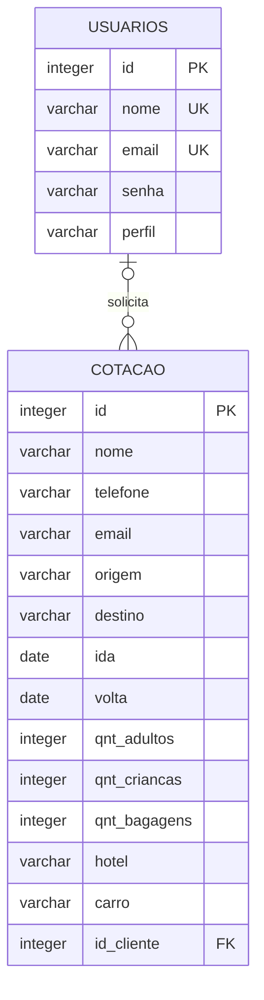
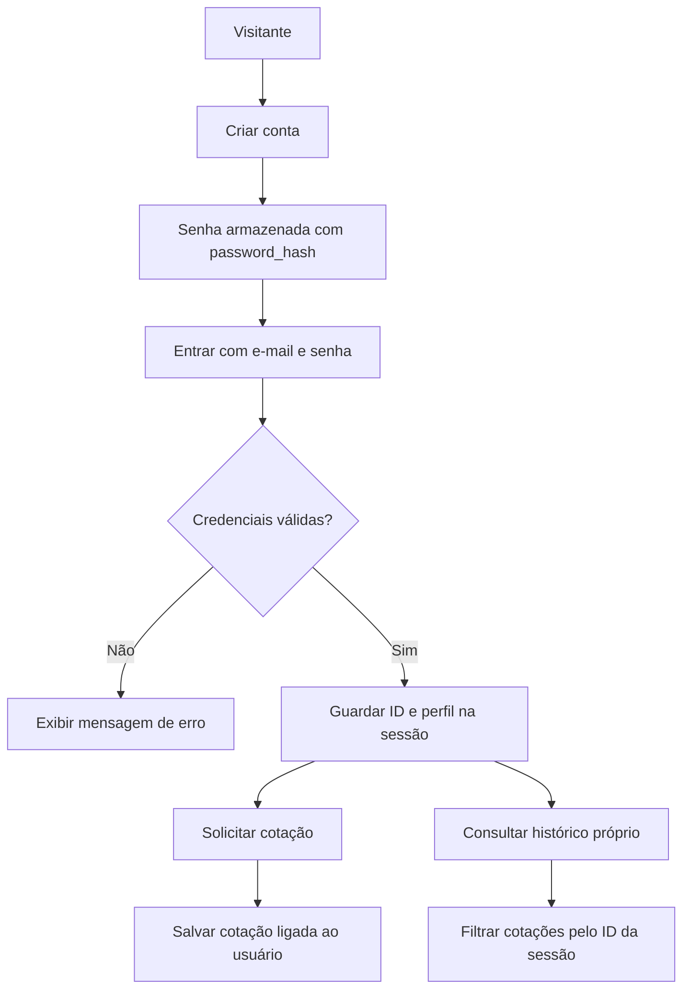
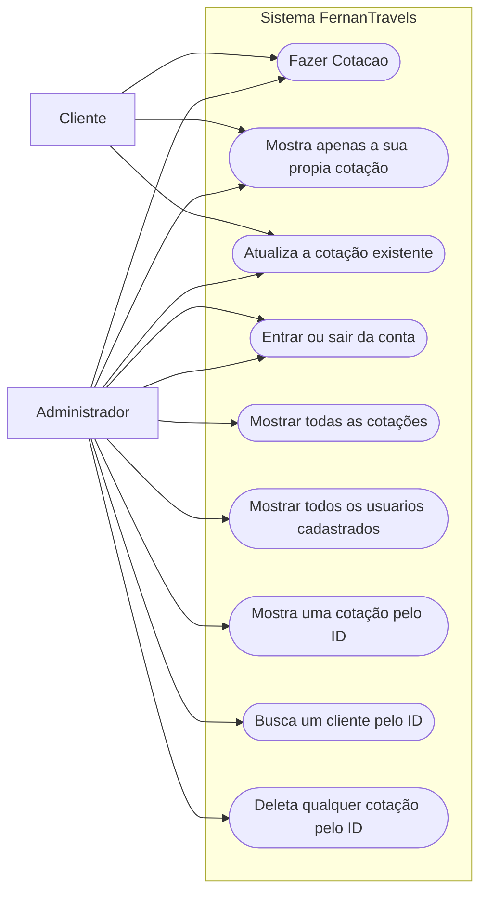

# FernanTravels

Aplicação web da agência de viagens **FernanTravels**, desenvolvida em PHP e PostgreSQL. O sistema permite criar contas, autenticar usuários e solicitar, consultar e atualizar cotações de viagem. Também possui páginas para consultar clientes e cotações.

## Funcionalidades

- Cadastro de usuário com nome, e-mail e senha armazenada com `password_hash()`.
- Login e logout com sessão PHP; a senha é conferida com `password_verify()`.
- Proteção de páginas que exigem autenticação.
- Criação de cotação com dados de contato, origem, destino, datas, passageiros, bagagens e opções de hotel e carro.
- Consulta do histórico de cotações do usuário autenticado.
- Atualização de cotação, limitada ao usuário proprietário na operação de gravação.
- Páginas de consulta para listar cotações, listar clientes, consultar um cliente e consultar o histórico de um cliente.
- Exclusão de cotação por ID.
- Menu administrativo exibido para usuários cuja sessão tenha o perfil `admin`.

> As páginas administrativas requerem login. Antes de disponibilizar o sistema publicamente, confirme que cada página administrativa também exige o perfil de administrador no servidor, e não apenas no menu.

## Tecnologias

- PHP
- PostgreSQL
- PDO com o driver `pdo_pgsql`
- HTML
- CSS

## Requisitos

- PHP 7 ou superior, com as extensões `PDO` e `pdo_pgsql`.
- PostgreSQL 18 e o cliente `psql` (o dump foi gerado com PostgreSQL 18.6).
- Git (opcional, para clonar o repositório).
- Navegador web atualizado.

## Como executar localmente

### 1. Obter o projeto

Clone o repositório e entre na pasta:

```bash
git clone https://github.com/GabrielGouvea01/fernantravels.git
cd fernantravels
```

O arquivo `database/fernantravels_backup.sql` já estará na pasta `database`.

### 2. Criar e restaurar o banco de dados

O dump contém a estrutura e os registros existentes no momento em que foi gerado. Ele não cria o banco nem o usuário do PostgreSQL. Como os objetos do dump pertencem ao usuário `fernantravels`, crie esse usuário e um banco vazio antes da restauração. No pgAdmin, conectado ao servidor local:

1. Crie um usuario chamado `fernantravels` e defina uma senha.
2. Crie um banco chamado `fernantravels` e escolha `fernantravels` como proprietário.
3. Abra o PowerShell e execute o comando abaixo, ajustando o caminho caso tenha salvado o arquivo em outra pasta:

```powershell
psql -h localhost -p 5432 -U fernantravels -d fernantravels -f "/database/fernantravels_backup.sql"
```

```sql
-- execute em uma sessão psql conectada a um banco administrativo
CREATE USER fernantravels WITH PASSWORD 'sua_senha';
CREATE DATABASE fernantravels OWNER fernantravels;
```

Se usar os comandos SQL acima, execute `CREATE DATABASE` fora de um bloco de transação. A restauração deve ser feita em um banco vazio; ela recria as tabelas, sequências, restrições e os registros incluídos no dump.

> **Atenção:** o dump inclui dados de usuários e cotações, além de hashes de senha. Trate-o como dado sensível, use-o apenas em ambiente local/autorizado e não restaure sobre um banco que contenha dados que queira preservar.

### 3. Configurar a conexão

Edite `database/connect.php` para usar o endereço, o nome do banco, o usuário e a senha definidos no seu PostgreSQL. Não publique credenciais reais no GitHub.

```php
$host = 'localhost';
$dbname = 'NOME_DB';
$user = 'SEU_USUARIO_POSTGRES';
$pass = 'SUA_SENHA';
```

### 4. Iniciar o servidor PHP

Execute o comando a partir da pasta raiz do projeto:

```bash
php -S localhost:8000
```

Abra [http://localhost:8000](http://localhost:8000) no navegador.

### 5. Criar uma conta administrativa

1. Cadastre uma conta pela página de cadastro do sistema.
2. No PostgreSQL, altere o perfil da conta que deverá administrar o sistema:

```sql
UPDATE usuarios
SET perfil = 'admin'
WHERE email = 'admin@exemplo.com';
```

3. Entre novamente na aplicação para que a sessão carregue o perfil atualizado.

Novas contas recebem o perfil `cliente` por padrão. O sistema não cria uma conta administrativa inicial.

## Estrutura do projeto

```text
FernanTravels/
├── admin/
│   ├── cliente.php
│   ├── deletar_cotacao.php
│   ├── historico_cliente.php
│   ├── ver_clientes.php
│   └── ver_cotacoes.php
├── app/
│   ├── atualizar_cota.php
│   ├── historico.php
│   └── nova_cotacao.php
├── database/
│   ├── connect.php
│   └── fernantravels_backup.sql
├── image/
│   └── logo_oficial.jpg
├── includes/
│   ├── footer.php
│   ├── functions.php
│   └── header.php
├── login/
│   ├── admin.php
│   ├── cadastrar_usuario.php
│   ├── login.php
│   ├── logout.php
│   └── verifica_user.php
├── Style/
│   └── style.css
└── index.php
```

### Páginas principais

| Caminho | Descrição |
| --- | --- |
| `index.php` | Apresentação da FernanTravels. |
| `login/cadastrar_usuario.php` | Formulário para criar uma conta. |
| `login/login.php` | Autentica uma conta e inicia a sessão. |
| `login/logout.php` | Encerra a sessão atual. |
| `app/nova_cotacao.php` | Formulário de solicitação de cotação; exige login. |
| `app/historico.php` | Lista as cotações associadas ao usuário autenticado. |
| `app/atualizar_cota.php` | Busca e atualiza uma cotação. |
| `admin/ver_cotacoes.php` | Lista as cotações cadastradas. |
| `admin/ver_clientes.php` | Lista os clientes e a quantidade de cotações de cada um. |
| `admin/cliente.php` | Consulta um cliente pelo ID. |
| `admin/historico_cliente.php` | Consulta cotações pelo ID do cliente. |
| `admin/deletar_cotacao.php` | Exclui uma cotação pelo ID. |

### Arquivos compartilhados

- `database/connect.php`: cria a conexão PDO com o PostgreSQL.
- `includes/functions.php`: contém operações de cadastro e consulta de usuários, criação e atualização de cotações, histórico, listagem e exclusão.
- `includes/header.php` e `includes/footer.php`: componentes compartilhados da interface.
- `login/verifica_user.php`: inicia a sessão quando necessário e redireciona visitantes não autenticados para o login.
- `login/admin.php`: verifica se há sessão autenticada com perfil `admin`.
- `Style/style.css`: estilos compartilhados.
- `image/logo_oficial.jpg`: logo utilizada no cabeçalho.

## Funções utilizadas

As funções abaixo estão em `includes/functions.php`. As páginas chamam essas funções para executar tarefas repetidas, como consultar o banco e apresentar os resultados.

### Exibição e proteção de dados

>#### `escapar_html($valor)`

Prepara um valor antes de mostrá-lo dentro de uma página HTML. Converte caracteres especiais para que textos vindos de formulários ou do banco sejam exibidos como texto, em vez de serem interpretados como marcação HTML.

É usada ao exibir dados de usuários, mensagens e cotações.

>#### `exibir_cotacoes($cotacoes, $exibir_id = false)`

Recebe uma lista de cotações e mostra seus campos na página. Usa uma lista de nomes e rótulos para apresentar informações como origem, destino, datas, passageiros, hotel e carro.

- Se a lista estiver vazia, mostra que nenhuma cotação foi encontrada.
- Quando `$exibir_id` é `true`, também mostra o ID de cada cotação.
- Usa `escapar_html()` para preparar os valores exibidos.

### Cotações

>#### `nova_cotacao($conexao, $nome, $telefone, $email, $origem, $destino, $ida, $volta, $qnt_adultos, $qnt_criancas, $qnt_bagagens, $hotel, $carro, $id_cliente)`

Insere uma cotação na tabela `cotacao`. `$conexao` é a conexão PDO com o banco. Os demais parâmetros são os dados do formulário: nome, telefone e e-mail de contato; origem, destino, datas de ida e volta; quantidades de adultos, crianças e bagagens; respostas sobre hotel e carro; e o ID do usuário conectado.

O ID do usuário é gravado em `id_cliente`, relacionando o pedido à conta que o solicitou.

Os valores são enviados como parâmetros da consulta PDO, em vez de serem concatenados diretamente no SQL.

>#### `atualizar_cotacao($conexao, $nome, $telefone, $email, $origem, $destino, $ida, $volta, $qnt_adultos, $qnt_criancas, $qnt_bagagens, $hotel, $carro, $id_cliente, $id)`

Atualiza os dados de contato e da viagem já descritos em `nova_cotacao()`. Recebe também `$id_cliente`, que identifica o dono da cotação, e `$id`, que identifica qual cotação será alterada. A consulta procura simultaneamente pelos dois IDs (`id` e `id_cliente`); assim, a gravação só acontece se a cotação pertencer à conta informada.

Ao final, mostra uma mensagem indicando se uma cotação foi atualizada ou se não foi encontrada para aquele usuário.

>#### `historico_unico($conexao, $id_cliente)`

Recebe a conexão PDO e o ID do usuário. Busca todas as cotações cujo `id_cliente` corresponda a esse ID, ordena pelo ID decrescente (mais recentes primeiro) e envia o resultado para `exibir_cotacoes()`.

É usada para mostrar o histórico do usuário conectado e também na consulta administrativa de histórico por cliente.

>#### `historico_geral($conexao)`

Recebe a conexão PDO, busca todas as cotações da tabela, ordena pelo ID decrescente e mostra os resultados usando `exibir_cotacoes()`. É usada na página de listagem geral de cotações.

>#### `deletar_cotacao($conexao, $id)`

Recebe a conexão PDO e o ID da cotação a ser excluída. Apaga da tabela `cotacao` a linha correspondente e informa se uma cotação foi removida ou se o ID não foi encontrado.

### Usuários

>#### `cadastrar_user($conexao, $nome, $email, $senha)`

Recebe a conexão PDO, o nome, o e-mail e a senha informados no cadastro. Cria uma conta na tabela `usuarios`. Antes de salvar, transforma a senha usando `password_hash()`. O login compara essa senha protegida com a senha digitada usando `password_verify()`.

>#### `consulta_user($conexao, $email)`

Recebe a conexão PDO e o e-mail digitado. Procura um usuário pelo e-mail e retorna os dados necessários para o login: ID, e-mail, senha armazenada e perfil. Se não houver uma conta com esse e-mail, retorna um resultado vazio.

>#### `unico_usuario($conexao, $id)`

Recebe a conexão PDO e o ID do usuário. Procura essa conta e, quando a encontra, mostra o nome, o e-mail e a quantidade de cotações associadas. Se o ID não corresponder a uma conta, mostra que o usuário não foi encontrado.

>#### `mostrar_usuarios($conexao)`

Recebe a conexão PDO, busca os usuários cadastrados e mostra o ID, nome, e-mail e a quantidade de cotações de cada um. Se não encontrar contas, informa que não há clientes para listar.

>#### `quantidade_cotacoes($conexao, $id_cliente)`

Recebe a conexão PDO e o ID do usuário. Conta quantas linhas da tabela `cotacao` estão ligadas a essa conta pelo campo `id_cliente` e devolve o total como número. É chamada por `unico_usuario()` e `mostrar_usuarios()`.

> `consultar()` e `atribuir_id()` existem no arquivo de funções, mas não são chamadas pelas páginas atuais; por isso, não são descritas como parte do funcionamento em uso.

## Banco de dados

O PostgreSQL armazena os dados em duas tabelas principais. `usuarios` guarda as contas e `cotacao` guarda os pedidos de viagem. O relacionamento é feito pelo campo `id_cliente` da cotação, que aponta para `usuarios.id`.

### Tabela `usuarios`

Guarda as contas usadas para entrar no sistema.

| Campo | Tipo | Funcionamento |
| --- | --- | --- |
| `id` | `INTEGER PRIMARY KEY` com sequência | Número identificador criado pelo PostgreSQL para cada conta. É usado por outras partes do sistema para reconhecer o usuário. |
| `nome` | `VARCHAR(150) NOT NULL UNIQUE` | Nome da pessoa. É obrigatório e não pode se repetir conforme a definição atual da tabela. |
| `email` | `VARCHAR(150) NOT NULL UNIQUE` | E-mail usado no login. É obrigatório e deve ser único. |
| `senha` | `VARCHAR(255) NOT NULL` | Guarda o resultado de `password_hash()`, não a senha digitada em texto simples. |
| `perfil` | `VARCHAR(20) NOT NULL DEFAULT 'cliente'` | Informa o tipo da conta. O banco define `cliente` como padrão; o menu administrativo verifica o valor `admin`. |

### Tabela `cotacao`

Guarda os dados de contato e as preferências de cada pedido de cotação. Cada linha representa uma solicitação.

| Campo | Tipo | Funcionamento |
| --- | --- | --- |
| `id` | `INTEGER PRIMARY KEY` com sequência | Número identificador da cotação, criado pelo PostgreSQL. |
| `nome` | `VARCHAR(100) NOT NULL` | Nome de contato informado no formulário da cotação. |
| `telefone` | `VARCHAR(20) NOT NULL` | Telefone de contato armazenado como texto, preservando números com zeros iniciais e permitindo formatação. |
| `email` | `VARCHAR(100) NOT NULL` | E-mail de contato para a solicitação. |
| `origem` | `VARCHAR(100) NOT NULL` | Local de partida informado. |
| `destino` | `VARCHAR(100) NOT NULL` | Destino pretendido. |
| `ida` | `DATE NOT NULL` | Data planejada para a ida. |
| `volta` | `DATE NOT NULL` | Data planejada para a volta. |
| `qnt_adultos` | `INTEGER NOT NULL` | Quantidade de adultos incluída na viagem. |
| `qnt_criancas` | `INTEGER NOT NULL` | Quantidade de crianças incluída na viagem. |
| `qnt_bagagens` | `INTEGER NOT NULL` | Quantidade de bagagens informada. |
| `hotel` | `VARCHAR(50) NOT NULL` | Resposta sobre incluir hotel na cotação, enviada pelo formulário como `sim` ou `nao`. |
| `carro` | `VARCHAR(50) NOT NULL` | Resposta sobre incluir carro na cotação, enviada pelo formulário como `sim` ou `nao`. |
| `id_cliente` | `INTEGER REFERENCES usuarios(id)` | Liga a cotação à conta que a solicitou. A função de criação preenche esse campo com o ID salvo na sessão. |

### Como as tabelas trabalham juntas

1. O usuário cria uma conta. O banco gera seu `usuarios.id` e define `perfil` como `cliente`, a menos que seja alterado manualmente.
2. Ao fazer login, a aplicação procura a conta pelo e-mail e guarda `id` e `perfil` na sessão.
3. Ao solicitar uma cotação, a aplicação salva os dados do formulário na tabela `cotacao` e usa o ID da sessão em `id_cliente`.
4. Para mostrar o histórico do usuário, a aplicação consulta as linhas em que `cotacao.id_cliente` é igual ao ID da sessão.
5. Para contar as cotações de um cliente, a aplicação conta quantas linhas da tabela `cotacao` usam aquele `id_cliente`.

O relacionamento representado no diagrama é de um usuário para várias cotações. No dump atual, `id_cliente` referencia `usuarios.id`, mas não está marcado como `NOT NULL`; portanto, o banco permite uma cotação sem usuário associado, mesmo que o fluxo normal da aplicação envie o ID da sessão.



## Fluxo de autenticação e cotação



## Observações

- Use credenciais próprias no ambiente local e mantenha-as fora do controle de versão.
- Para que o perfil apareça no menu administrativo, a sessão precisa conter `perfil = 'admin'`.
- As rotas e os recursos descritos neste README correspondem aos arquivos atualmente presentes no projeto; o sistema não implementa reservas, pagamentos, emissão de passagens, notificações ou histórico de alteração de status de cotações.


### 5.2 Diagrama de casos de uso

O diagrama resume as ações disponíveis para clientes e administradores. A autorização das telas administrativas é verificada no servidor.

